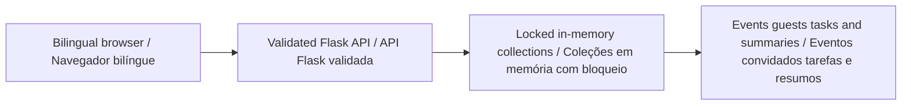

# Event Planning Workspace

### Central de Planejamento de Eventos

[](https://github.com/galafis/Event-Planning-System/actions/workflows/ci.yml)
[English](#english) · [Português](#portugues) · [Examples / Exemplos](examples/review_demo.py) · [Validation / Validação](docs/VALIDATION.md)

**Web applications / Aplicações web** · Working prototype / Protótipo funcional · Gabriel Demetrios Lafis

<a id="english"></a>

## English

A Flask application for creating events, tracking budgets and guests, and following event tasks through a bilingual browser workspace and JSON API.

### What works

- Working landing page with event creation, budget summaries, task completion and deletion.
- CRUD endpoints for events plus guest, vendor and task operations.
- Validation happens before mutation; deleting an event also removes its registered guests.

### Reproducible walkthrough

Requirements: Python 3.12 / Python 3.12.

Run from the repository root. The validation environment installs the components exercised by the tests and documented example; optional integrations may need their separate dependencies.

```sh
python -m venv .venv
# Activate .venv for your shell / Ative .venv no seu terminal
python -m pip install -r requirements-validation.txt
python -m pytest -q
python -m examples.review_demo
```

**Input contract / Contrato de entrada:** JSON objects / objetos JSON; ISO date `YYYY-MM-DD`; nonnegative budget / orçamento não negativo.

**Expected behavior / Comportamento esperado:** The walkthrough creates event 3, adds a task and guest, and verifies 3 events, 3 guests and a total budget of 76500. / O roteiro cria o evento 3, adiciona tarefa e convidado e verifica 3 eventos, 3 convidados e orçamento total de 76500.

### Architecture / Arquitetura



The main path can be followed in [src/main.py](src/main.py). Examples call the actual implementation and include assertions; they are not pseudocode.

### Scope and assumptions

This is a local, single-process prototype with in-memory storage. Restarting clears changes. It has no authentication, persistent database, payments or invitation delivery. Task and event examples are synthetic.

### Changes verified in this review

Restored the missing landing template; validated dates, quantities, references and statuses; serialized in-process access and fixed orphaned guests after deletion.

<a id="portugues"></a>

## Português

Aplicação Flask para criar eventos, acompanhar orçamentos e convidados e controlar tarefas por uma interface bilíngue e API JSON.

### Funcionalidades disponíveis

- Página funcional com criação de eventos, resumo de orçamentos, conclusão de tarefas e exclusão.
- Endpoints CRUD de eventos e operações com convidados, fornecedores e tarefas.
- A validação ocorre antes de alterar dados; excluir um evento também remove seus convidados cadastrados.

### Execução reproduzível

Use os comandos da seção acima a partir da raiz do repositório. Requisitos: Python 3.12 / Python 3.12. O ambiente de validação instala os componentes exercitados pelos testes e pelo exemplo documentado; integrações opcionais podem exigir dependências próprias.

O fluxo principal está em [src/main.py](src/main.py). Os exemplos usam a implementação real e verificam resultados com asserções; não são pseudocódigo. O diagrama apresenta os mesmos passos nos dois idiomas.

### Escopo e premissas

Protótipo local de processo único com armazenamento em memória. Reiniciar apaga alterações. Não possui autenticação, banco persistente, pagamentos ou envio de convites. Os exemplos de tarefas e eventos são fictícios.

### Melhorias verificadas nesta revisão

Restaurado o template ausente; validados datas, quantidades, referências e status; serializado acesso no processo e corrigidos convidados órfãos após exclusão.

### Run the application / Executar a aplicação

```sh
python -m src.main
```

Open / Abra: http://127.0.0.1:5000.

## Repository guide / Guia do repositório

| Location / Local                                            | Purpose / Finalidade                                                   |
| ----------------------------------------------------------- | ---------------------------------------------------------------------- |
| [Implementation / Implementação](src/main.py)               | Main domain behavior / Comportamento principal do domínio              |
| [Example / Exemplo](examples/review_demo.py)                | Executable scenario / Cenário executável                               |
| [Tests / Testes](tests/)                                    | Normal behavior and failure cases / Fluxos válidos e casos de falha    |
| [Validation notes / Notas de validação](docs/VALIDATION.md) | Corrections, evidence and boundaries / Correções, evidências e limites |
| [Workflow / Automação](.github/workflows/ci.yml)            | Automated checks / Verificações automatizadas                          |

- [Executed example result / Resultado executado do exemplo](examples/expected.json)

## Development / Desenvolvimento

EN: When changing behavior, update the contract, the worked example and a regression test together. Keep synthetic fixtures separate from real data. A passing test suite demonstrates the listed software behaviors; it does not certify a deployment or domain outcome.

PT: Ao alterar comportamento, atualize em conjunto o contrato, o exemplo e um teste de regressão. Separe amostras fictícias de dados reais. Testes aprovados demonstram os comportamentos de software listados; não certificam implantação nem resultado no domínio.

Author / Autor: [Gabriel Demetrios Lafis](https://github.com/galafis) · [Institutional contact / Contato institucional](mailto:gabrieldemetrioslafis@usp.br)

License / Licença: [repository license](LICENSE).
